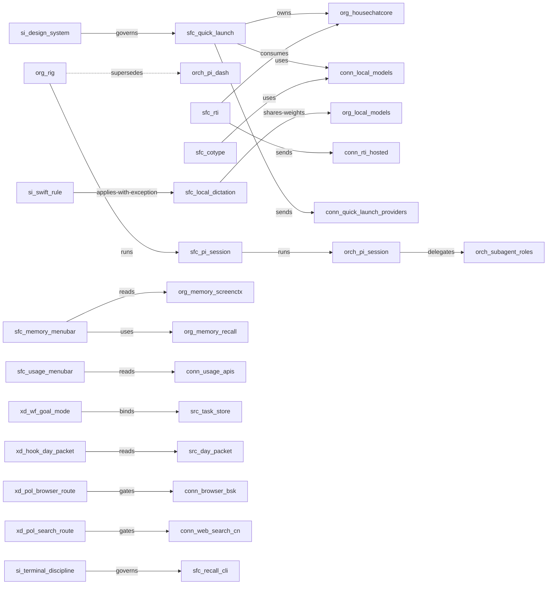

# House System map

> Generated from `catalog/catalog.yaml` by `tools/build_system_map.py`.
> Do not hand-edit. Run `make map` and commit the result.

Relationships between child repositories are owned by `house/atlas.yaml`;
this map shows the catalog's layer inventory and the inter-layer edges the
catalog is allowed to hold. See `docs/architecture.md` for the layer model.

## Inventory

| Layer | Records | Current | Experimental | Aspirational |
| --- | ---: | ---: | ---: | ---: |
| Surfaces | 11 | 9 | 2 | 0 |
| Shared Interaction | 18 | 18 | 0 | 0 |
| Orchestration | 7 | 6 | 1 | 0 |
| Connectors | 23 | 23 | 0 | 0 |
| Organs | 9 | 6 | 2 | 1 |
| Sources | 11 | 11 | 0 | 0 |
| Relationships | 21 | 20 | 0 | 1 |
| Execution Fabric / Tools | 15 | 15 | 0 | 0 |
| Execution Fabric / Skills | 66 | 65 | 1 | 0 |
| Execution Fabric / Extensions | 21 | 18 | 3 | 0 |
| Execution Fabric / Hooks | 9 | 9 | 0 | 0 |
| Execution Fabric / Workflows | 7 | 6 | 1 | 0 |
| Execution Fabric / Policies | 6 | 6 | 0 | 0 |
| **Total** | **224** | | | |

## Layer stack

```
  surfaces          apps, menu-bar panels, CLIs, this repo's map
  shared interaction one visual and Swift rule (design-system)
  orchestration     sessions, subagents, goals, control plane
  execution fabric  tools, skills, extensions, hooks, workflows, policies
  capabilities      connectors to external services + local organs
  sources           one owning record per fact, referenced not copied
  personal context  private day packet and identity, outside this repo
```

## Surfaces

| Id | Name | Status | Visibility | Description |
| --- | --- | --- | --- | --- |
| `sfc-quick-launch` | Quick Launch | current | private | Keyboard-first launcher and instant AI overlay; owns the HouseChatCore package shared with RTI. |
| `sfc-rti` | RTI | current | private | Meeting capture (recording, live transcript, screenshots, raw session archive to the private knowledge vault) and the in-meeting copilot; analysis and summaries happen downstream, not in the app. Its chats, standalone ones included, are grounded in sessions and the vault; general chat is Quick Launch AI Chat. |
| `sfc-local-dictation` | Local Dictation | current | private | Hold a key, talk, release, and the text lands at the cursor; on-device, never uploaded. Runs its own models in the app for latency and shares only the ~/Models weight store. First candidate for signed public distribution. |
| `sfc-cotype` | Cotype | experimental | private | Local AI autocomplete in the menu bar; streams completions from the Local Models daemon (gemma-it) and inserts accepted ghost text; the in-process engine is a legacy fallback. Installed, not yet in daily use. |
| `sfc-memory-menubar` | Memory | current | private | Menu-bar face of the memory layer: the screen-context collector's state and switch (read from screenctx), and capture, search and today over the memory repository (through recall). |
| `sfc-usage-menubar` | Usage | current | private | One menu-bar panel for every metered hosted AI source (subscriptions and API balances) on the same percent-used axis. |
| `sfc-local-models-menubar` | Local Models | current | private | Menu-bar face of the local-models daemon: which local models are warm, load and unload, the daemon switch. Usage shows the quota of hosted metered AI; this shows local models. |
| `sfc-recall-cli` | recall | current | private | Capture-and-search CLI over the memory repository and open tasks; reached from Quick Launch saved actions and the Memory panel; no screen data. |
| `sfc-screenctx` | screenctx | current | private | Screen-context collector CLI: accessibility-first text capture and frame-on-change stills with local vision enrichment. |
| `sfc-rig` | rig | experimental | private | Terminal workstation for Pi agents across projects: one tmux session per seat, a shared dashboard session with a narrow phone layout, and verbs to start, send, stop, resume, snapshot and restore. |
| `sfc-pi-session` | Pi session | current | private | The terminal agent surface that carries the House execution fabric; the parent session orchestrates and owns the final answer. |

## Shared Interaction

| Id | Name | Status | Visibility | Description |
| --- | --- | --- | --- | --- |
| `si-design-system` | House design rule (Slate) | current | private | One visual rule for every House app: monochrome warm neutrals, one status dot, one radius/spacing/type scale, shared panel glass. |
| `si-swift-rule` | House Swift rule | current | private | One code rule: I/O services are actors, structured concurrency, Swift Testing for new targets, the deployment target wins. |
| `si-launcher-panel` | Launcher panel | current | private | Input row, section labels, 40 px rows with tile plus key caps, and a footer well. |
| `si-composer` | Composer | current | private | Shared pill composer for Quick Launch and RTI: growth to a bounded line limit, command circle, real primary action, visible attachment state. |
| `si-chat-context-record` | Chat context record | current | private | Compact answer detail showing effective model, provider destination, reasoning, used sources and phase timings. |
| `si-quick-ai` | Quick AI surface | current | private | Fixed 750 by 475 overlay with a thread, a bounded composer and Recent Chats. |
| `si-ai-chat-window` | AI Chat window | current | private | Titled window at the shared size with a persisted frame, find bar, and a hidden chat rail. |
| `si-settings-shell` | Settings shell | current | private | 220 px rail, card groups with uppercase section labels, ink toggles, footer well. |
| `si-pill` | Dictation pill | current | private | Shared panel glass, cancel-on-hover, waveform that rests near-flat in silence, explicit processing stages. |
| `si-chips` | Chips | current | private | 28 px chips where recording is the only chroma. |
| `si-menubar-panel` | Menu bar panel | current | private | 300 px glass panel in place of a system menu: header with status dot, action rows, footer well. |
| `si-meter-row` | Meter row | current | private | One percent-used axis per window, aligned provider columns, no colour, unknown draws an empty track. |
| `si-status-item` | Status item | current | private | One template SF Symbol at one size and weight; outline when idle, filled means on, colour only with a word. |
| `si-selected-text-preview` | Selected text preview | current | private | Popover with the source app and a complete selectable text view before the text is used. |
| `si-dictation-recovery` | Dictation recovery detail | current | private | Saved audio with playback plus raw and processed text versions; local audio with a default retention window. |
| `si-session-browser` | Session browser | current | private | RTI session rows, file selectors, a capped readable column, and confirmed deletion for owned archives. |
| `si-setup-checklist` | Setup checklist | current | private | Standalone permission panel that re-reads state about once a second so a grant lands without a relaunch. |
| `si-terminal-discipline` | Terminal surface discipline | current | private | The same rule without chrome: monochrome, uppercase section labels, two-column rows, one-line status, no boxes or emoji. |

## Orchestration

| Id | Name | Status | Visibility | Description |
| --- | --- | --- | --- | --- |
| `orch-pi-session` | Parent session | current | private | Owns decomposition, decision, integration and the final answer; chooses the minimum workflow for a request. |
| `orch-subagent-roles` | Subagent roster | current | private | Seven fixed roles (scout, researcher, analyst, worker, producer, reviewer, verifier) plus the local Helium executor, each with its own tool allowlist. |
| `orch-pi-workflows` | Plan, Goal and workflow bridge | current | private | plan mode, Goal lifecycle and the cooperative workflow bridge that binds a goal to an existing project task record. |
| `orch-pi-dash` | Pi control plane | current | private | The in-Pi /dash: a session control plane and dashboard that runs inside a Pi session. Installed, no longer grown; rig is set to replace it (stack decision 2026-09-24). |
| `orch-interactive-subagents` | Interactive subagents | current | private | Spawns, steers and resumes subagent sessions in dedicated tmux panes; completion is delivered automatically. |
| `orch-prewalk` | Prewalk handoff | experimental | private | Mid-session model handoff: a strong model plans and lands the first edit, a cheaper one continues the same trajectory. |
| `orch-session-checklist` | Session checklist | current | private | Parent-session progress display for substantial multi-step work; never a canonical task store. |

## Connectors

| Id | Name | Status | Visibility | Description |
| --- | --- | --- | --- | --- |
| `conn-email-ops` | Work email (Outlook) | current | private | Read, search and draft work email through the sanctioned CLI; the CLI cannot send. |
| `conn-gmail-read` | Personal Gmail | current | private | Read-only personal mail search through the local CLI; never a browser and never a write. |
| `conn-google-workspace-read` | Personal Google Workspace | current | private | Read-only access to own documents and file metadata; no export, no sharing, no write. |
| `conn-slack-ops` | Slack | current | private | Read, search and draft; posting needs an explicit send instruction. |
| `conn-calendar-ops` | Work calendar | current | private | Agenda, free slots, holds, invitations, RSVPs, moves and cancellations. |
| `conn-float` | Float | current | private | Availability, allocations, projects, people, phases and time off. |
| `conn-office365-graph` | SharePoint and OneDrive | current | private | File search, download, read, upload, move and rename through the sanctioned Office CLI. |
| `conn-web-search` | Web search (global) | current | private | One tool over an ordered provider chain that reports which provider served each call. |
| `conn-web-search-cn` | Web search (Chinese) | current | private | Chinese-first index covering Dianping, Amap, Xiaohongshu, Zhihu, WeChat and review sites. |
| `conn-social-data` | Social and marketplace data | current | private | Public posts and listings across many platforms, plus venue address enrichment. |
| `conn-local-models` | Local model daemon | current | private | Text, vision and completion requests to the shared local serving layer; nothing leaves the machine. |
| `conn-local-tts` | Local text to speech | current | private | Speech synthesis over the always-on localhost service. |
| `conn-transcribe` | Hosted transcription | current | private | Audio and video transcription for the media lanes. |
| `conn-rti-hosted` | RTI live transcription and assistant | current | private | RTI streams both live audio legs to Soniox by default, sends retained audio to Soniox's file API for the transcript upgrade, and sends assistant turns to the chosen LLM provider. OCR stays on the Mac. |
| `conn-quick-launch-providers` | Quick Launch hosted providers | current | private | Answers go to a hosted provider only when the chosen model is hosted; the answer detail names the destination. Keys live in the macOS Keychain. |
| `conn-usage-apis` | AI usage and balance endpoints | current | private | Usage reads quota and balance from each provider; it sends no prompt or content. Antigravity is read through its local CLI. |
| `conn-pi-models` | Pi model providers | current | private | Every Pi call reaches a hosted model: the agent session and rig seats. |
| `conn-telegram` | Telegram phone doorbell | current | private | Send-only notices to the owner's phone through the Mac's notifier; two-way replies are not built. |
| `conn-browser-bsk` | Interactive browser | current | private | Automation of the existing logged-in browser session through the browser CLI and extension. |
| `conn-helium-local` | Private local browser executor | current | private | Bounded exact-label execution with local models; no navigation and no free-form page read. |
| `conn-iphone-use` | iPhone agent | current | private | Drives a real iPhone for apps that have no API. |
| `conn-cloud-workspace` | Cloud workspace | current | private | Runs a bounded, phone-durable job remotely and returns verified artifacts. |
| `conn-github` | GitHub | current | private | Repository creation, inspection and push through the authenticated CLI; private by default. |

## Organs

| Id | Name | Status | Visibility | Description |
| --- | --- | --- | --- | --- |
| `org-design-system` | design-system | current | private | Machine source of every visual value plus the generators, component registry, lint and the two House rules. |
| `org-local-models` | local-models | current | private | Shared local serving layer: model registry, daemon (owns weights, load and unload), CLIs and a Swift client; the Local Models menu bar is its face. |
| `org-local-tts` | local-tts | current | private | Always-on on-device voice service; the text-to-speech organ of the local layer. |
| `org-memory-screenctx` | memory-screenctx | current | private | The one screen-history collector: accessibility-first text capture with local vision enrichment and a queryable store. |
| `org-memory-recall` | memory-recall | current | private | Capture-and-search CLI over the memory repository and open tasks: capture hands a thought to the memory repository's capture CLI (remember is a hidden alias), search scans its markdown. Reads no screen data. |
| `org-housechatcore` | HouseChatCore | current | private | Chat core package owned by Quick Launch and consumed by RTI; the shared seam between the two apps. |
| `org-rig` | rig | experimental | private | Seat layer for Pi: a pane-hosted runner that drives Pi over RPC, writes per-seat state files from typed events, and a launchd snapshot every five minutes; no daemon and no database. |
| `org-house-system` | house-system | experimental | private | Architecture catalog, generated system map and shared conventions for the House family; ships no product and owns no product state. |
| `org-release-conventions` | House release conventions | aspirational | private | A shared direct-distribution convention (Developer ID, hardened runtime, notarization, Sparkle EdDSA, HTTPS appcast, rollback) that each app applies locally. Design only until the human gates clear. |

## Sources

| Id | Name | Status | Visibility | Description |
| --- | --- | --- | --- | --- |
| `src-house-atlas` | house/atlas.yaml | current | private | Local relationship authority. This catalog references it and cross-checks project slugs during validation. |
| `src-code-atlas` | code-atlas.yaml | current | private | Portfolio authority above the house group; never duplicated inside this repository. |
| `src-design-values` | tokens.json | current | private | Single machine source of the design values; generated files carry its hash and are never retyped by hand. |
| `src-code-rule` | SWIFT.md | current | private | The code rule each repository links to and never copies. |
| `src-project-status` | Project status record | current | private | The human entry point of a project; the catalog's status field is a summary, never the authority. |
| `src-task-store` | Project task store | current | private | Canonical task records; a session checklist and a generated view are never the store. |
| `src-decision-record` | Accepted decision record | current | private | One record per decision; a discussion or quotation never creates one. |
| `src-personal-identity` | Personal identity store | current | private | Human-gated and intentionally not mirrored in this repository. Referenced as a boundary only; no content is copied here. |
| `src-day-packet` | Day packet | current | private | A derived view. Read-only, never hand-edited, and not a memory store. |
| `src-session-archive` | Session archive | current | private | A source archive under its privacy rules; never promoted to truth automatically. |
| `src-catalog` | catalog.yaml | current | private | This file. It describes; it does not authorise and it does not replace any record above. |

## Execution Fabric / Tools

| Id | Name | Status | Visibility | Description |
| --- | --- | --- | --- | --- |
| `xd-tool-read` | read | current | private | Read file contents, text or image attachment. |
| `xd-tool-write` | write | current | private | Create or overwrite a file. |
| `xd-tool-edit` | edit | current | private | Targeted exact-text replacement with multiple disjoint edits per call. |
| `xd-tool-bash` | bash | current | private | Run a shell command in the working directory; guarded by the bash policy. |
| `xd-tool-web-search` | web_search | current | private | One search tool over a provider chain, reporting which provider served each result. |
| `xd-tool-web-search-cn` | web_search_cn | current | private | Chinese-first search for China and Shanghai-local sources. |
| `xd-tool-web-fetch` | web_fetch | current | private | Static URL read as clean Markdown. |
| `xd-tool-subagent` | subagent | current | private | Spawn an isolated child agent; its result is delivered as a steer message. |
| `xd-tool-subagent-message` | subagent_message | current | private | Steer a running child or resume a finished one by name. |
| `xd-tool-subagents-list` | subagents_list | current | private | List available agent definitions and their scopes. |
| `xd-tool-ask-question` | ask_question | current | private | Ask the parent one blocking question instead of guessing. |
| `xd-tool-update-plan` | update_plan | current | private | Parent-session checklist for substantial multi-step execution. |
| `xd-tool-workflow` | workflow_start_plan / workflow_start_goal | current | private | Enter plan mode or bind a goal to an existing canonical task record. |
| `xd-tool-goal` | goal | current | private | Control-plane tool for assignments across top-level sessions. |
| `xd-tool-checklist` | checklist | current | private | Collapse, hide, show or clear the current session checklist. |

## Execution Fabric / Skills

| Id | Name | Status | Visibility | Description |
| --- | --- | --- | --- | --- |
| `xd-skill-email-ops` | email-ops | current | private | Work email (Outlook) read, search and draft through the sanctioned CLI. Draft only. |
| `xd-skill-gmail-read` | gmail-read | current | private | Read-only personal Gmail through a local CLI; never a browser, never a write. |
| `xd-skill-google-workspace-read` | google-workspace-read | current | private | Read-only personal Docs, Sheets, Slides and Drive metadata. |
| `xd-skill-slack-ops` | slack-ops | current | private | Read, search and draft Slack messages; posting needs an explicit send instruction. |
| `xd-skill-calendar-ops` | calendar-ops | current | private | Agenda, free slots, holds, invitations, RSVPs and cancellations. |
| `xd-skill-float` | float | current | private | Availability, allocations, projects, people, phases and time off. |
| `xd-skill-office365-graph` | office365-graph | current | private | SharePoint and OneDrive files: search, download, read, upload, move, rename. |
| `xd-skill-bocha-search` | bocha-search | current | private | Chinese-language search against the Bocha index. |
| `xd-skill-searxng` | searxng | current | private | Self-hosted search stack: web search, URL to Markdown, structured extraction, search-answer, images. |
| `xd-skill-image-search` | image-search | current | private | Search and download images from social, art-directed and general sources. |
| `xd-skill-social-data` | social-data | current | private | Public social and marketplace data across many platforms, plus venue address enrichment. |
| `xd-skill-analyze-sessions` | analyze-sessions | current | private | Cost, prompts and session mining over the local session archive. |
| `xd-skill-tdd` | tdd | current | private | Test-first feature and bug work with integration tests. |
| `xd-skill-diagnosing-bugs` | diagnosing-bugs | current | private | Diagnosis loop for hard bugs and performance regressions. |
| `xd-skill-codebase-design` | codebase-design | current | private | Vocabulary and method for deep module interfaces and seams. |
| `xd-skill-subagent-creation` | subagent-creation | current | private | Design, create, revise or retire a subagent without role sprawl. |
| `xd-skill-ops-skill-development` | ops-skill-development | current | private | Create, update, route, test and audit service-lane skills and their hooks. |
| `xd-skill-cloud-workspace` | cloud-workspace | current | private | Run a bounded, phone-durable job on the private cloud workspace over SSH. |
| `xd-skill-product-description` | product-description | current | private | Write an outside-in behavior description of a product from code and tests, then verify it against the running product. |
| `xd-skill-file-ops` | file-ops | current | private | Artifact pointers, variants, drift hashes, adoption and supersession through a project owner file. |
| `xd-skill-stop-slop` | stop-slop | current | private | Deterministic slop gate plus judgment pass before prose leaves the building. |
| `xd-skill-case-studies` | case-studies | current | private | Pull, format and anonymize case studies from the registry. |
| `xd-skill-parse-brief` | parse-brief | current | private | Turn a research brief into one structured research-ops artifact. |
| `xd-skill-proposal` | proposal | current | private | Create and render research proposals. |
| `xd-skill-proposal-score` | proposal-score | current | private | Score a draft proposal against nine pillar rubrics. |
| `xd-skill-screener` | screener | current | private | Create and render bilingual recruitment screeners. |
| `xd-skill-dg` | dg | current | private | Create and render bilingual discussion guides. |
| `xd-skill-dg-workbook` | dg-workbook | current | private | Build the strategist synthesis workbook from transcripts plus a discussion guide. |
| `xd-skill-costing` | costing | current | private | Generate, validate and render research costings. |
| `xd-skill-findings-doc` | findings-doc | current | private | Write one research session into a skimmable findings document. |
| `xd-skill-findings-corpus` | findings-corpus | current | private | Synthesize per-group findings into one cross-group comparison. |
| `xd-skill-findings-cross-cut` | findings-cross-cut | current | private | Test which axis governs a study and output the segmentation verdict. |
| `xd-skill-frame` | frame | current | private | Surface the governing frame that reorganizes a report. |
| `xd-skill-frame-check` | frame-check | current | private | Blind-challenge a frame against its evidence before it shapes a decision. |
| `xd-skill-insight` | insight | current | private | Write and gate consumer insights to a high bar. |
| `xd-skill-implications` | implications | current | private | Turn findings and insights into client decisions with calibrated confidence. |
| `xd-skill-report-skeleton` | report-skeleton | current | private | Build the report argument spine before any format. |
| `xd-skill-report-transpose` | report-transpose | current | private | Transpose an approved skeleton into the chosen shape and render it. |
| `xd-skill-thought-starters` | thought-starters | current | private | Write point-of-view slides anchored by data points. |
| `xd-skill-kickoff-deck` | kickoff-deck | current | private | Build a kickoff deck that aligns the team and locks decisions before fieldwork. |
| `xd-skill-deck-audit` | deck-audit | current | private | Audit a deck for argument strength, narrative and consulting quality. |
| `xd-skill-deck-control` | deck-control | current | private | Route deck creation, structural work, review and QA through existing deck state. |
| `xd-skill-deck-ops` | deck-ops | current | private | Build, render, convert and verify a deck through the measured HTML or Python-DSL lane. |
| `xd-skill-deck-edit` | deck-edit | current | private | Bounded edits to an existing native deck. |
| `xd-skill-ic-deck-render` | ic-deck-render | current | private | Render content into branded PowerPoint decks. |
| `xd-skill-ic-deck-fingerprint` | ic-deck-fingerprint | current | private | Measure a deck against the empirical register fingerprint. |
| `xd-skill-ic-deck-image-hunter` | ic-deck-image-hunter | current | private | Source, select and place images into a deck. |
| `xd-skill-ic-docx-render` | ic-docx-render | current | private | Word engine for extract, edit, comment and generate. |
| `xd-skill-pptx-edit` | pptx-edit | current | private | Bounded edits to an existing native PowerPoint file. |
| `xd-skill-keynote-edit` | keynote-edit | current | private | Inspect and make bounded edits to an existing native Keynote file. |
| `xd-skill-html-deck-export` | html-deck-export | current | private | Author HTML decks that convert cleanly to editable PowerPoint. |
| `xd-skill-open-kimi-ppt` | open-kimi-ppt | current | private | Create, replicate and export presentations through the PPTD route. |
| `xd-skill-live-ppt-edit` | live-ppt-edit | current | private | Edit a deck in the live studio beside the chat, reloaded from disk. |
| `xd-skill-gantt` | gantt | current | private | Render Gantt and timeline slides from markdown. |
| `xd-skill-transcribe` | transcribe | current | private | Transcribe audio or video to text through a hosted engine. |
| `xd-skill-transcript` | transcript | current | private | Format and render finished research transcripts as branded Word output. |
| `xd-skill-transcript-qa` | transcript-qa | current | private | Recover speakers, clean bounded ASR errors, verify names and gate the clean copy. |
| `xd-skill-transcript-translation` | transcript-translation | current | private | Translate long speaker-diarized transcripts into research-grade English with deterministic QA. |
| `xd-skill-translate` | translate | current | private | Translate or review documents, text, Excel workbooks and decks. |
| `xd-skill-speaker-map` | speaker-map | current | private | Map speaker labels to real participants with evidence. |
| `xd-skill-local-tts` | local-tts | current | private | Speak text aloud or synthesize a WAV with the on-device voice service. |
| `xd-skill-local-image-analysis` | local-image-analysis | current | private | Analyze images privately with local vision models; OCR and schema-validated JSON. |
| `xd-skill-epub-audiobook` | epub-audiobook | current | private | Turn an EPUB into a chaptered audiobook using the on-device voice. |
| `xd-skill-browser-skill` | browser-skill | current | private | Drive the logged-in Chromium browser through the browser CLI and extension. |
| `xd-skill-iphone-use` | iphone-use | current | private | Drive a real iPhone through the local agent API for apps with no other route. |
| `xd-skill-typesafe-ai` | typesafe-ai | experimental | private | Build AI features as small typed judgments and probabilities rather than prompt-and-parse. |

## Execution Fabric / Extensions

| Id | Name | Status | Visibility | Description |
| --- | --- | --- | --- | --- |
| `xd-ext-ops-hooks` | ops-hooks | current | private | Loads the fresh day packet into each request and fires the matching ops skill deterministically. |
| `xd-ext-bash-guard` | bash-guard | current | private | Blocks destructive shell commands and enforces protected-root search scope. |
| `xd-ext-browser-route-guard` | browser-route-guard | current | private | Classifies each turn's browser route and gates UI, fetch and private lanes accordingly. |
| `xd-ext-search-route-guard` | search-route-guard | current | private | Routes Chinese queries to the Chinese-first lane by script rather than by model taste. |
| `xd-ext-pi-workflows` | pi-workflows | current | private | Plan mode, Goal mode and the cooperative workflow bridge as one package. |
| `xd-ext-pi-dash` | pi-dash | current | private | The in-Pi /dash control plane and tmux dashboard; no longer grown, to be retired once rig covers it. |
| `xd-ext-interactive-subagents` | interactive-subagents | current | private | Spawn, orchestrate and manage subagent sessions in tmux panes. |
| `xd-ext-effort-budget` | effort-budget | current | private | Conservative effort and scope budget; clamps subagent deadlines under a tight budget. |
| `xd-ext-document-modes` | document-modes | current | private | Selects the document work mode from a request prefix. |
| `xd-ext-prewalk` | prewalk | experimental | private | Mid-session model handoff after the first landed edit. |
| `xd-ext-status-line` | status-line | current | private | Context and cost footer that drops secondary segments as the terminal narrows. |
| `xd-ext-short-session-name` | short-session-name | current | private | Generates a short session title in the user's language. |
| `xd-ext-custom-header` | custom-header | current | private | Replaces the startup header with an editable copy. |
| `xd-ext-close-tmux-session` | close-tmux-session | current | private | Exits Pi and closes the current tmux session. |
| `xd-ext-ask-user-question` | ask-user-question | current | private | Interactive question editor used by the blocking-question tool. |
| `xd-ext-web-search` | web-search | current | private | Provider-chain web search with per-result provider reporting. |
| `xd-ext-web-search-cn` | web-search-cn | current | private | Chinese-first search lane. |
| `xd-ext-web-fetch` | web-fetch | current | private | Clean-Markdown URL read with a reader fallback. |
| `xd-ext-helium-local` | helium-local | current | private | Bounded exact-label executor over an already-open browser window with no navigation. |
| `xd-ext-codex-fetch-recover` | codex-fetch-recover | experimental | private | Recovers a fetch when the primary reader returns too little content. |
| `xd-ext-video-extract` | video-extract | experimental | private | Video frame and audio extraction helper for the media lanes. |

## Execution Fabric / Hooks

| Id | Name | Status | Visibility | Description |
| --- | --- | --- | --- | --- |
| `xd-hook-day-packet` | Day packet injection | current | private | Reads the fresh, generated daily packet into each request's system prompt; never a memory write. |
| `xd-hook-ops-skill-trigger` | Ops skill trigger | current | private | Loads the exact mail, calendar, Slack or file service for the request instead of relying on skill discovery. |
| `xd-hook-browser-route` | Browser route classification | current | private | Classifies the browser route from raw user input and gates UI, fetch and private lanes per turn. |
| `xd-hook-search-route` | Search route classification | current | private | Chooses the Chinese or global search lane from the query's script. |
| `xd-hook-destructive-shell` | Destructive shell gate | current | private | Refuses destructive bash and out-of-scope recursive searches; proposes an alternative instead of retrying. |
| `xd-hook-document-mode` | Document mode selection | current | private | Applies the document work mode named by the request prefix. |
| `xd-hook-effort-budget` | Effort budget clamp | current | private | Clamps read-only lookups and subagent deadlines under an enforced quick budget. |
| `xd-hook-status-footer` | Status footer render | current | private | Shows model, context and cost, dropping secondary segments as the terminal narrows. |
| `xd-hook-session-title` | Session title | current | private | Generates a short session title in the user's language. |

## Execution Fabric / Workflows

| Id | Name | Status | Visibility | Description |
| --- | --- | --- | --- | --- |
| `xd-wf-plan-mode` | Plan mode | current | private | Formal planning with a review and approval gate; section comments are drafts until sent for revision. |
| `xd-wf-goal-mode` | Goal mode | current | private | Binds long work to a canonical task record with an objective, constraints, acceptance and verification, and pauses at configured limits. |
| `xd-wf-workflow-bridge` | Workflow bridge | current | private | Cooperative bridge that enters the Goal lifecycle for bound long work without a second driver. |
| `xd-wf-document-modes` | Document work modes | current | private | First build, fast edit and final polish select the document cut; a draft-feedback request defaults to fast edits. |
| `xd-wf-prewalk` | Prewalk | experimental | private | Strong model plans and lands the first edit; a cheap model continues the same trajectory. |
| `xd-wf-maker-checker` | Maker then checker | current | private | Whoever built a thing does not ship its verdict; the verification pass runs in a fresh context. |
| `xd-wf-quick-images` | Quick Images | current | private | Streamlined image sourcing and placement mode for a document. |

## Execution Fabric / Policies

| Id | Name | Status | Visibility | Description |
| --- | --- | --- | --- | --- |
| `xd-pol-bash-guard` | Destructive shell and search scope | current | private | No recursive traversal of protected roots, no destructive commands; narrow the path instead of overriding. |
| `xd-pol-browser-route` | One browser route per turn | current | private | Static fetch, interactive browser, private local executor and native UI each get their own gate; fail closed. |
| `xd-pol-search-route` | Search lane by script | current | private | Chinese sources go to the Chinese-first lane; English and global go to the provider chain. |
| `xd-pol-draft-only` | Draft-only communications | current | private | Email and Slack are draft-only until an explicit send or post instruction; Gmail is read-only with no writes at all. |
| `xd-pol-one-authority` | One fact, one owning record | current | private | Write to the owner; a derived view is never hand-edited, and a session cache never becomes truth. |
| `xd-pol-no-silent-publish` | No silent publish or spend | current | private | Committing is scoped, and publishing, purchasing, deploying and making a repository public need an explicit human decision. |

## Inter-layer relationships



| Id | From | To | Kind | Description |
| --- | --- | --- | --- | --- |
| `rel-rig-runs-pi-sessions` | `org-rig` | `sfc-pi-session` | runs | Each rig seat is a Pi session in RPC mode under the rig runner, using the normal Pi agent directory; the dashboard lives outside every Pi session. |
| `rel-rig-supersedes-pi-dash` | `org-rig` | `orch-pi-dash` | supersedes (aspirational) | rig's dashboard lives outside every Pi session; the in-Pi /dash retires once rig covers what it does. Not done yet. |
| `rel-design-rule-governs-surfaces` | `si-design-system` | `sfc-quick-launch` | governs | Every House surface draws its values from the one design rule; design-system is the source, apps are consumers. |
| `rel-swift-rule-governs-local-dictation` | `si-swift-rule` | `sfc-local-dictation` | applies-with-exception | Local Dictation is a Rust app, so it follows the design rule and its own crate conventions rather than the Swift rule. |
| `rel-quicklaunch-owns-chatcore` | `sfc-quick-launch` | `org-housechatcore` | owns | The chat core is owned by Quick Launch and consumed by RTI; one owner, two consumers. |
| `rel-rti-consumes-chatcore` | `sfc-rti` | `org-housechatcore` | consumes | RTI adopts the shared chat core while keeping its own sources and tests. |
| `rel-quicklaunch-uses-local-models` | `sfc-quick-launch` | `conn-local-models` | uses | Local answers run against the local serving layer; hosted models go through conn-quick-launch-providers. |
| `rel-cotype-uses-local-models` | `sfc-cotype` | `conn-local-models` | uses | Completions stream from the daemon-managed llama-server (gemma-it); the daemon owns the weights and their load and unload. The in-process engine is an opt-in legacy fallback. |
| `rel-memory-menubar-uses-collector` | `sfc-memory-menubar` | `org-memory-screenctx` | reads | The panel runs screenctx status for collector state and capture counts, and switches the collector on and off. |
| `rel-memory-menubar-uses-recall` | `sfc-memory-menubar` | `org-memory-recall` | uses | Capture, search and today in the panel run the recall CLI; the panel never writes the memory repository itself. |
| `rel-dictation-shares-model-store` | `sfc-local-dictation` | `org-local-models` | shares-weights | Weights live in the shared ~/Models store; Cohere MLX and S1-mini run in the app, not through the daemon (daemon transcription is phase 2). |
| `rel-rti-sends-to-hosted` | `sfc-rti` | `conn-rti-hosted` | sends | Meeting audio and assistant turns leave the machine by default; this is RTI's named exception to local first. |
| `rel-quicklaunch-hosted-providers` | `sfc-quick-launch` | `conn-quick-launch-providers` | sends | Only when a hosted model is chosen; local models go through conn-local-models. |
| `rel-usage-reads-provider-apis` | `sfc-usage-menubar` | `conn-usage-apis` | reads | Quota and balance only, never content. |
| `rel-pi-session-orchestrates` | `sfc-pi-session` | `orch-pi-session` | runs | The terminal agent surface runs the parent session. |
| `rel-orchestrator-delegates` | `orch-pi-session` | `orch-subagent-roles` | delegates | The parent session decomposes work and delegates within the fixed roster. |
| `rel-goal-binds-task` | `xd-wf-goal-mode` | `src-task-store` | binds | A bound goal names an existing canonical task record; it never creates a parallel store. |
| `rel-day-packet-feeds-pi` | `xd-hook-day-packet` | `src-day-packet` | reads | The hook reads the generated packet into each request and writes nothing back. |
| `rel-browser-policy-gates-browser` | `xd-pol-browser-route` | `conn-browser-bsk` | gates | The browser policy decides whether the interactive lane may be used this turn. |
| `rel-search-policy-gates-cn` | `xd-pol-search-route` | `conn-web-search-cn` | gates | Chinese-script queries are routed to the Chinese-first lane. |
| `rel-terminals-follow-rule` | `si-terminal-discipline` | `sfc-recall-cli` | governs | CLI surfaces express the design rule as text discipline. |

## Enforcement

| Policy | Enforced by | Event |
| --- | --- | --- |
| Destructive shell and search scope | `xd-ext-bash-guard` | tool_call |
| One browser route per turn | `xd-ext-browser-route-guard` | before_agent_start + tool_call |
| Search lane by script | `xd-ext-search-route-guard` | before_agent_start |
| Draft-only communications | `xd-ext-ops-hooks` | before_agent_start |
| One fact, one owning record | `xd-ext-ops-hooks` | before_agent_start |
| No silent publish or spend | `xd-ext-ops-hooks` | before_agent_start |

## References

- **house/atlas.yaml** (`src-house-atlas`) — owner: house group (hand-edited); authority: project-to-project relationships and each child repository's role inside the house group
- **code-atlas.yaml** (`src-code-atlas`) — owner: code directory (hand-edited, generated views derived); authority: portfolio purpose, tier, activity and wiring for the whole code directory
- **tokens.json** (`src-design-values`) — owner: design-system; authority: every visual value: colour, type, spacing, radius, shadow, control height
- **SWIFT.md** (`src-code-rule`) — owner: design-system; authority: Swift concurrency, test framework, platform floors and the iOS build path
- **Project status record** (`src-project-status`) — owner: each project; authority: a project's objective and current state
- **Project task store** (`src-task-store`) — owner: each project; authority: open and closed work items
- **Accepted decision record** (`src-decision-record`) — owner: owning project or memory writer; authority: accepted decisions and their rationale
- **Personal identity store** (`src-personal-identity`) — owner: private memory store (not this repository); authority: identity, preferences and direction
- **Day packet** (`src-day-packet`) — owner: ops-hooks (generated, read-only); authority: the bounded daily context handed to a fresh agent request
- **Session archive** (`src-session-archive`) — owner: the agent runtime; authority: what happened in a session transcript
- **catalog.yaml** (`src-catalog`) — owner: house-system; authority: the descriptive inventory of House components, their maturity and their exposure
